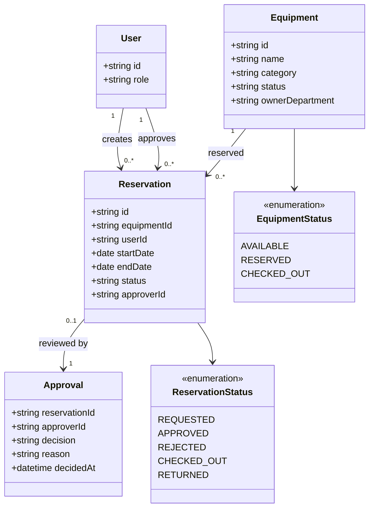

# 도메인 모델

> 문서 지도: [index](index.md) · [source](source.md) · [glossary](glossary.md) · [domain](domain.md) · [processes](processes.md) · [flows](flows.md) · [validation](validation.md)

## 엔티티·값 객체

| 구성요소 | 이름 | 속성·책임 | 관계·불변식 | 출처 | 확실성 |
| --- | --- | --- | --- | --- | --- |
| 엔티티 | User | id, role | 예약 생성자·승인자·운영자·관리자 역할 | p.2 | 추론 |
| 엔티티 | Equipment | id, name, category, status, ownerDepartment | 예약 대상. 기간별 가용성 필요 | p.5 | 확정 |
| 엔티티 | Reservation | id, equipmentId, userId, startDate, endDate, status, approverId | User·Equipment와 연결. 중복 예약 금지 | p.5 | 확정 |
| 엔티티 | Approval | reservationId, approverId, decision, reason, decidedAt | Reservation에 0..1. 승인자·SLA 미정의 | p.2, p.5 | 추론 |
| 값 객체 | ReservationPeriod | startDate, endDate | 종료일은 시작일 이상 | p.3, p.5 | 추론 |
| 값 객체 | EquipmentCategory | 노트북, 프로젝터, 카메라 | 분류 목록은 예시이며 전체 목록 미정의 | p.2 | 모호 |
| 열거형 | ReservationStatus | REQUESTED, APPROVED, REJECTED, CHECKED_OUT, RETURNED | 취소·연체·노쇼 상태 없음 | p.5 | 확정 |
| 열거형 | EquipmentStatus | 사용 가능, 예약됨, 대여 중 | 상태 목록과 전이 조건 미정의 | p.4, p.5 | 모호 |

## 관계

- User 1 : N Reservation (생성자)
- User 1 : N Reservation (승인자, `approverId`)
- Equipment 1 : N Reservation
- Reservation 0..1 : 1 Approval (추론)
- Reservation은 하나의 ReservationStatus를 가진다.
- Equipment는 하나의 EquipmentStatus를 가진다.

## 상태 전이

| 현재 | 이벤트 | 다음 | 조건 | 출처 | 확실성 | 관련 |
| --- | --- | --- | --- | --- | --- | --- |
| REQUESTED | 승인 | APPROVED | 승인자 승인 | p.3, p.5 | 확정 | [P](processes.md#p-reservation-approve-01), [F](flows.md#f-reservation-approve-01), [V](validation.md#v-perm-approver-01) |
| REQUESTED | 반려 | REJECTED | 승인자 반려 | p.3, p.5 | 확정 | [P](processes.md#p-reservation-approve-01), [F](flows.md#f-reservation-approve-01) |
| APPROVED | 수령 | CHECKED_OUT | 운영자 대여 처리 | p.3, p.5 | 추론 | [P](processes.md#p-reservation-checkout-01), [F](flows.md#f-reservation-checkout-01) |
| CHECKED_OUT | 반납 | RETURNED | 운영자 반납 처리 | p.3, p.5 | 추론 | [P](processes.md#p-reservation-return-01), [V](validation.md#v-proc-return-01) |
| APPROVED | 취소 | CANCELED | 취소 정책 필요 | p.3 | 미정의 | [V](validation.md#v-proc-cancel-01) |
| CHECKED_OUT | 기한 초과 | OVERDUE | 연체 정책 필요 | p.3 | 미정의 | [V](validation.md#v-status-overdue-01) |
| APPROVED | 미수령 | NO_SHOW | 노쇼 정책 필요 | p.5 | 미정의 | [V](validation.md#v-proc-cancel-01) |

## 불변식

- 같은 장비에 승인·대여 상태의 예약이 기간상 겹치면 안 된다. [p.3]
- CHECKED_OUT은 APPROVED에서만 가능하다. [추론]
- RETURNED는 CHECKED_OUT에서만 가능하다. [추론]
- 종료일은 시작일보다 빠를 수 없다. [추론]
- 예약 화면에는 수량 입력이 있지만 예약 데이터 모델에는 수량이 없다. 데이터 모델 보완이 필요하다. [p.4, p.5]

## Mermaid 클래스 다이어그램

- `Approval`은 `approverId`와 승인 절차에서 추론했습니다.
- `ReservationPeriod`와 `EquipmentStatus`의 전체 값은 원문에 없습니다.
- 취소·연체·노쇼 상태는 원문에 없으므로 다이어그램에 넣지 않았습니다.

## 모델 가정과 질문

- User를 별도 엔티티로 볼지, 사내 계정 시스템의 참조로 볼지 확인이 필요합니다.
- 예약 승인 이력을 Reservation의 필드로 둘지, Approval 엔티티로 분리할지 결정해야 합니다.
- 장비 재고를 개별 장비 단위로 볼지, 분류별 수량으로 볼지 정해야 합니다.
- 예약 수량을 데이터 모델에 추가할지, 1예약 1장비로 제한할지 정해야 합니다.
