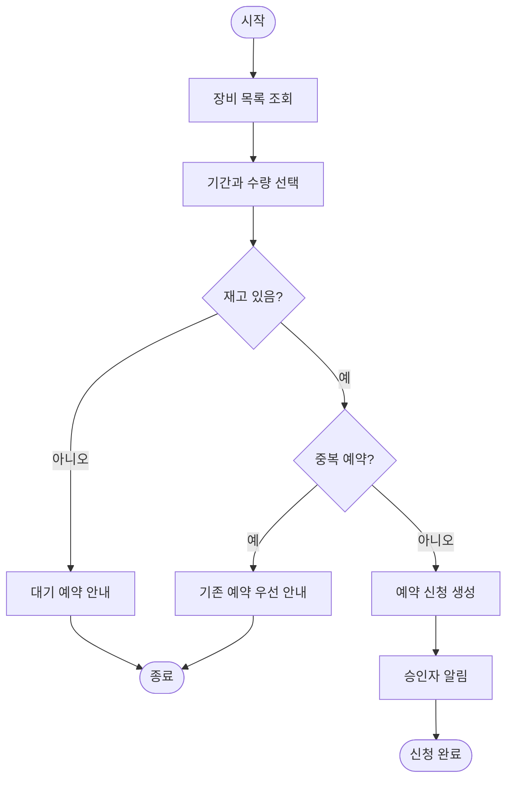
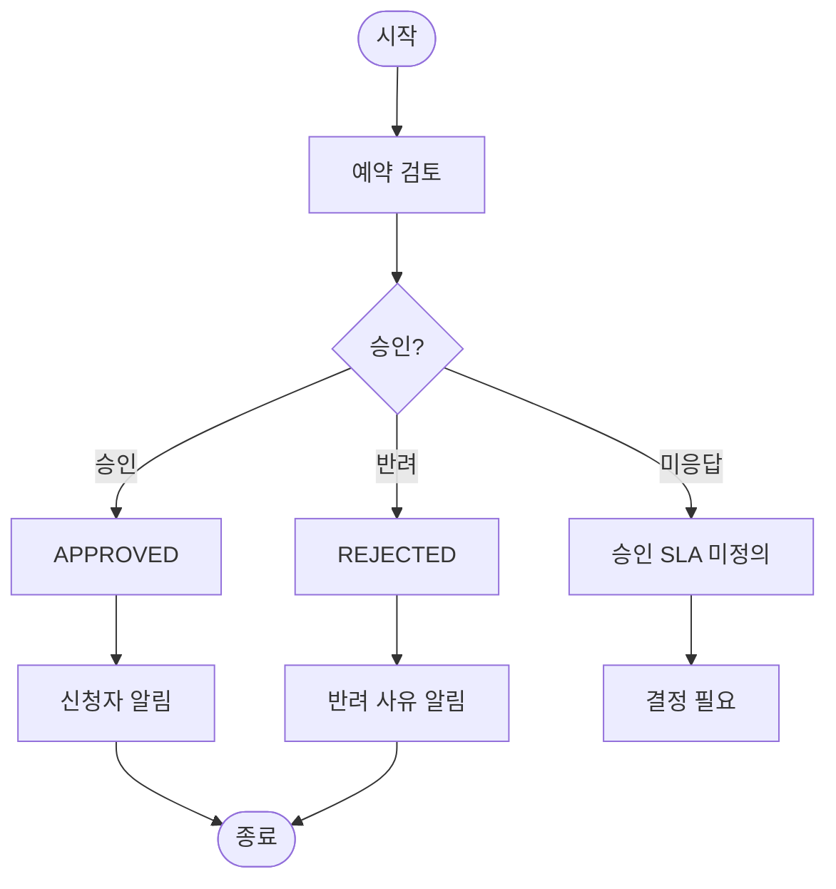
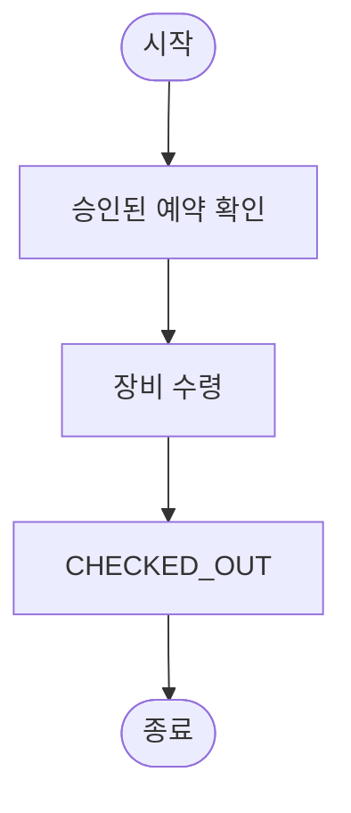

# 플로우차트

> 문서 지도: [index](index.md) · [source](source.md) · [glossary](glossary.md) · [domain](domain.md) · [processes](processes.md) · [flows](flows.md) · [validation](validation.md)

## F-RESERVATION-CREATE-01 예약 신청 (P-RESERVATION-CREATE-01)

- 관련: [프로세스 P-RESERVATION-CREATE-01](processes.md#p-reservation-create-01), [검증 V-DATA-INVENTORY-01](validation.md#v-data-inventory-01)

- 원문에 없는 취소·변경 분기는 넣지 않았습니다.
- `대기 예약`의 생성·해제 규칙은 원문에 없어 안내에서 멈춥니다.

## F-RESERVATION-APPROVE-01 예약 승인 (P-RESERVATION-APPROVE-01)

- 관련: [프로세스 P-RESERVATION-APPROVE-01](processes.md#p-reservation-approve-01), [검증 V-PERM-APPROVER-01](validation.md#v-perm-approver-01), [검증 V-PROC-APPROVAL-01](validation.md#v-proc-approval-01)

- 승인자 역할과 미응답 처리(SLA)가 없어 마지막 분기는 질문으로 끝납니다.
- 반려 사유 코드는 원문에 없습니다.

## F-RESERVATION-CHECKOUT-01 장비 수령·대여 (P-RESERVATION-CHECKOUT-01, 부분 정의)

- 관련: [프로세스 P-RESERVATION-CHECKOUT-01](processes.md#p-reservation-checkout-01), [검증 V-TERM-RESERVATION-01](validation.md#v-term-reservation-01)

- 원문은 "임직원이 운영자에게서 장비를 수령한다"만 기술합니다.
- 상태 변경 주체, 수령 확인, 미수령 처리는 추론하지 않았습니다.

## F-RESERVATION-RETURN-01 반납 (P-RESERVATION-RETURN-01, 미정의)

- 관련: [프로세스 P-RESERVATION-RETURN-01](processes.md#p-reservation-return-01), [검증 V-PROC-RETURN-01](validation.md#v-proc-return-01), [검증 V-STATUS-OVERDUE-01](validation.md#v-status-overdue-01)

프로세스가 미정의되어 플로우차트를 그리지 않았습니다. 원문에는 "반납은 운영자가 처리한다"만 있습니다. 반납 단계, 연체 판정, 파손·분실 처리가 정의된 뒤 다이어그램을 추가해야 합니다.

## F-RESERVATION-CANCEL-01 취소·변경·노쇼 (P-RESERVATION-CANCEL-01, 미정의)

- 관련: [프로세스 P-RESERVATION-CANCEL-01](processes.md#p-reservation-cancel-01), [검증 V-PROC-CANCEL-01](validation.md#v-proc-cancel-01)

프로세스가 미정의되어 플로우차트를 그리지 않았습니다. 1차 출시 범위 포함 여부와 상태 정의가 먼저 필요합니다.

## 검증 메모

- P-RESERVATION-CREATE-01의 재고 판정은 기간·수량 기준이 없어 `재고 있음?`을 단일 결정으로 표현했습니다.
- P-RESERVATION-APPROVE-01의 승인자 미응답은 정책이 없어 종료 상태가 아닌 `결정 필요`로 끝납니다.
- P-RESERVATION-CHECKOUT-01과 P-RESERVATION-RETURN-01 사이에 반납 예정일·연체 알림을 연결하는 흐름이 없습니다.
- P-RESERVATION-CANCEL-01이 없으면 예약 생명주기가 REQUESTED/APPROVED/CHECKED_OUT에서 취소·노쇼로 닫히지 않습니다.
